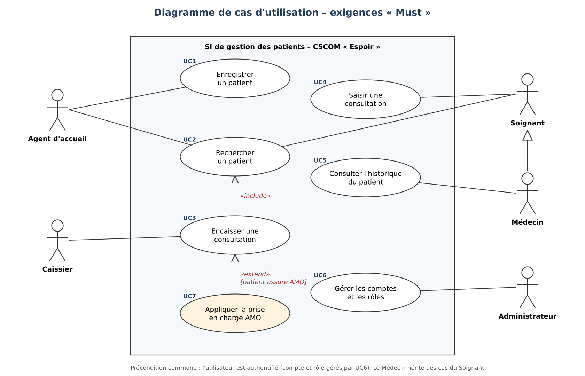

# TD3 – Cas d'utilisation

## 1. Acteurs et cas (à partir des exigences « Must »)

### Acteurs

| Acteur | Description |
|---|---|
| Agent d'accueil | Reçoit les patients, les recherche et les enregistre. |
| Caissier | Encaisse les consultations. |
| Soignant | Infirmier ou sage-femme : saisit les consultations. |
| Médecin | Hérite des cas du Soignant. En plus, il consulte l'historique médical. |
| Administrateur | Gère les comptes des utilisateurs et leurs droits. |

### Cas d'utilisation

| Cas | Nom | Acteur(s) | Exigence « Must » d'origine |
|---|---|---|---|
| UC1 | Enregistrer un patient | Agent d'accueil | US01 |
| UC2 | Rechercher un patient | Agent d'accueil, Soignant | US02 |
| UC3 | Encaisser une consultation | Caissier | US03 |
| UC4 | Saisir une consultation | Soignant (et Médecin) | US05 |
| UC5 | Consulter l'historique du patient | Médecin | US06 |
| UC6 | Gérer les comptes et les rôles | Administrateur | US08, ENF03 |
| UC7 | Appliquer la prise en charge AMO | (extension de UC3) | US03 (règle AMO) |

## 2. Relations

**Inclusion : UC3 « Encaisser une consultation » inclut UC2 « Rechercher un patient ».**
Justification : on ne peut jamais encaisser sans d'abord retrouver le dossier du patient, car le paiement doit être lié à un dossier. La recherche est donc **obligatoire à chaque fois**, ce qui correspond exactement à un « include ». Elle est aussi réutilisée par l'accueil et les soignants, ce qui évite de la décrire plusieurs fois.

**Extension : UC7 « Appliquer la prise en charge AMO » étend UC3 « Encaisser une consultation ».**
Justification : la prise en charge AMO ne se déclenche **que sous une condition** : le patient est assuré AMO. Dans ce cas, il paie 1 500 F au lieu de 5 000 F. Pour un patient non assuré, l'encaissement se fait normalement sans UC7. Un comportement optionnel et conditionnel correspond à un « extend ».

**Généralisation : Médecin → Soignant.** Le médecin peut faire tout ce que fait un soignant (UC4), plus consulter l'historique (UC5).

## 3. Scénarios détaillés de deux cas clés

### UC1 – Enregistrer un patient

| Élément | Contenu |
|---|---|
| Acteur principal | Agent d'accueil |
| Objectif | Créer un dossier unique pour un patient qui vient pour la première fois. |
| Préconditions | L'agent est connecté. La recherche (UC2) n'a trouvé aucun dossier pour ce patient. |
| Postconditions | Le dossier est créé avec un numéro unique. Le patient peut passer à la caisse. |

**Scénario nominal**
1. L'agent choisit « Nouveau patient ».
2. Le système affiche le formulaire d'enregistrement.
3. L'agent saisit le nom, le prénom, le sexe, la date de naissance, le téléphone, le quartier et, si le patient en a un, son numéro AMO.
4. L'agent valide.
5. Le système vérifie que les champs obligatoires sont remplis.
6. Le système vérifie qu'aucun patient n'a le même nom, le même prénom et la même date de naissance.
7. Le système crée le dossier, attribue un numéro unique (par exemple `CSE-2026-00125`) et l'affiche.
8. L'agent communique le numéro au patient et l'oriente vers la caisse.

**Scénario alternatif A1 : doublon possible (étape 6)**
- 6a. Le système trouve un patient qui ressemble et affiche ses informations.
- 6b. Si c'est la même personne, l'agent ouvre ce dossier existant. Aucun nouveau dossier n'est créé et le cas se termine.
- 6c. Si ce n'est pas la même personne, l'agent confirme qu'il s'agit d'un nouveau patient. Le scénario reprend à l'étape 7.

**Scénario d'erreur E1 : champ obligatoire manquant ou invalide (étape 5)**
- 5a. Le système met le champ en rouge et affiche un message, par exemple : « La date de naissance est obligatoire » ou « Numéro de téléphone invalide ».
- 5b. L'agent corrige. Le scénario reprend à l'étape 4.

### UC3 – Encaisser une consultation

| Élément | Contenu |
|---|---|
| Acteur principal | Caissier |
| Objectif | Encaisser le bon montant et remettre un reçu au patient. |
| Préconditions | Le caissier est connecté. Le patient a un dossier. |
| Postconditions | Le paiement est enregistré (date, heure, montant, caissier). Un reçu est imprimé. La consultation peut être saisie (UC4). |

**Scénario nominal**
1. Le caissier recherche le patient (**include UC2**) et ouvre son dossier.
2. Le caissier choisit « Encaisser une consultation ».
3. Le système vérifie si le patient a un numéro AMO valide. Ici, le patient n'est pas assuré.
4. Le système affiche le montant : **5 000 F**.
5. Le caissier encaisse l'argent et valide.
6. Le système enregistre le paiement et imprime le reçu.
7. Le caissier remet le reçu au patient et l'envoie en salle d'attente.

**Scénario alternatif A1 : patient assuré AMO (étape 3, extension UC7)**
- 3a. Le patient a un numéro AMO. Le système applique la prise en charge.
- 3b. Le système affiche le montant à payer, **1 500 F**, et la part AMO. Le scénario reprend à l'étape 5.

**Scénario d'erreur E1 : carte AMO non valide (étape 3a)**
- 3a1. Le caissier constate que la carte AMO est expirée ou que le numéro ne correspond pas.
- 3a2. Le caissier retire la prise en charge et le système affiche 5 000 F. Le scénario reprend à l'étape 4.

**Scénario d'erreur E2 : coupure de courant pendant la validation (étape 6)**
- 6a. Le paiement n'est enregistré que s'il a été entièrement validé : il n'y a pas d'enregistrement à moitié.
- 6b. Au redémarrage, le caissier consulte le dossier. Si le paiement n'apparaît pas, il recommence à l'étape 2.
