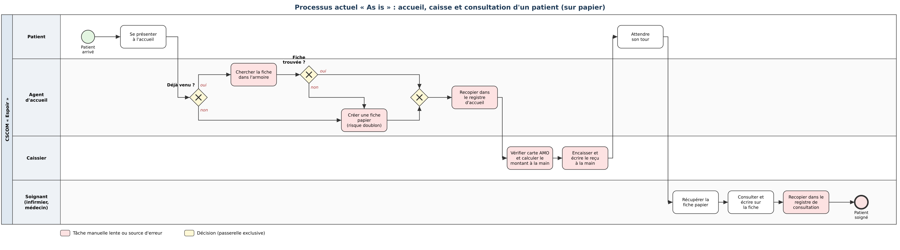
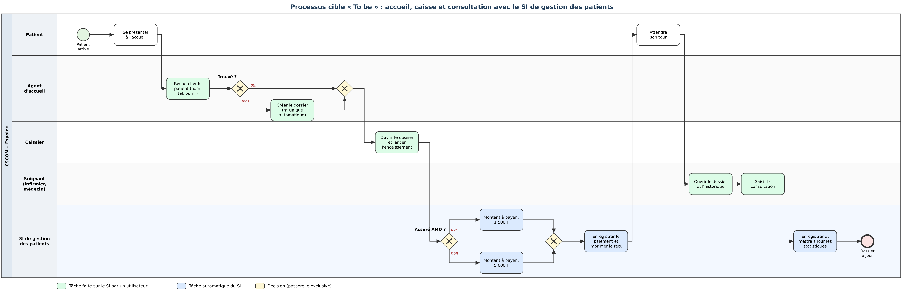

# TP3 – Modélisation BPMN « As is » et « To be »

Outil : **draw.io** (diagrams.net). Les fichiers modifiables sont dans le dossier `diagrammes/` (`.drawio`) : on peut les ouvrir sur https://app.diagrams.net avec *Fichier → Ouvrir depuis → Cet appareil*.

## 1. Processus actuel « As is »

Processus modélisé : accueil, paiement et consultation d'un patient, sur papier.
Les tâches en **rouge** sont manuelles, lentes ou sources d'erreur :
- la recherche de la fiche dans l'armoire ;
- la création d'une nouvelle fiche quand l'ancienne est introuvable, ce qui crée des **doublons** ;
- la recopie dans les registres ;
- le calcul du montant AMO à la main ;
- le reçu écrit à la main.

## 2. Processus cible « To be »

Ce qui change :
- une nouvelle **lane « SI de gestion des patients »** fait automatiquement le calcul du montant (5 000 F, ou 1 500 F avec l'AMO), l'enregistrement du paiement, l'impression du reçu et la mise à jour des statistiques ;
- l'agent **recherche** le patient dans le SI au lieu de fouiller l'armoire ;
- les recopies dans les registres papier **disparaissent**, car tout est saisi une seule fois.

## 3. Comparaison : trois gains attendus

| # | Gain | « As is » | « To be » | Objectif du cadrage |
|---|---|---|---|---|
| 1 | **Temps d'enregistrement réduit** | Fouille de l'armoire et recopie dans le registre : environ 15 min | Recherche par nom, téléphone ou n° en quelques secondes : 7 min au maximum | O1, O2 |
| 2 | **Plus de doublons ni de fiches perdues** | Une fiche introuvable donne une nouvelle fiche, donc un doublon | Numéro unique, contrôle des doublons, données sauvegardées | O3 |
| 3 | **Montants justes et statistiques automatiques** | Calcul AMO et reçus à la main ; rapport mensuel compté à la main en environ 5 jours | Montant calculé par le SI, reçu imprimé, statistiques mises à jour à chaque consultation : rapport en 1 jour | O4 |

En plus, le nombre de tâches manuelles passe de **6 tâches** (en rouge) dans le « as is » à **0** dans le « to be ».

> **À retenir :** BPMN décrit comment le travail s'organise ; les cas d'utilisation décrivent ce que le système apporte aux acteurs. Ici, chaque tâche verte du « to be » correspond à un cas d'utilisation : « Rechercher le patient » correspond à UC2, « Créer le dossier » à UC1, l'encaissement à UC3 et UC7, la saisie de la consultation à UC4, et l'ouverture de l'historique à UC5.
