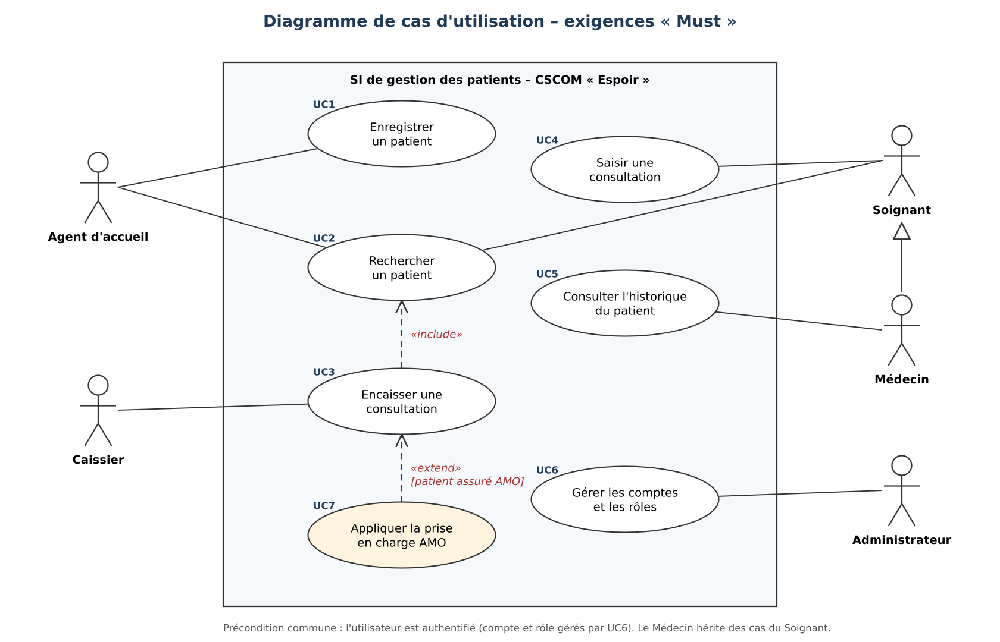

# TD/TP Système d'Information – Séance 3 : Cas d'utilisation et BPMN

**Groupe de travail :** Alassane Coulibaly, Djibril Diarra – Licence Génie logiciel
**Sujet fil rouge :** Informatisation de la gestion des patients du CSCOM « Espoir » (Bamako)

| Fichier | Partie | Durée |
|---|---|---|
| [08-cas-utilisation.md](08-cas-utilisation.md) | TD : acteurs et cas, include/extend, 2 scénarios détaillés | 1 h |
| [09-bpmn-as-is-to-be.md](09-bpmn-as-is-to-be.md) | TP : BPMN « as is », « to be » et 3 gains | 1 h |
| [livrable-seance3.pdf](livrable-seance3.pdf) | **Livrable** : diagrammes « as is » / « to be », cas d'utilisation, descriptions de 2 cas clés | — |
| [diagrammes/](diagrammes/) | Images PNG et fichiers draw.io modifiables | — |

> **À retenir :** BPMN décrit comment le travail s'organise, les cas d'utilisation décrivent ce que le système apporte aux acteurs ; l'un sert à dériver l'autre.
